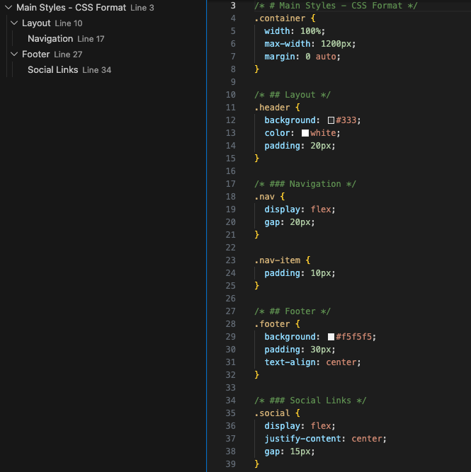

# Mokuji - 目次ジェネレーター

VS Codeの標準アウトライン機能を拡張し、コメントベースの目次をサイドバーに表示する拡張機能です。

VS Code標準のアウトラインがコード構造（関数、クラス等）を表示するのに対し、Mokujiはコメントや見出しで定義したカスタムセクションを表示します。ファイルのナビゲーション構造を自由にコントロールできます。

[English README](README.md)



## 機能

- 特別なコメント形式や見出しを認識し、最大6階層の目次を自動生成
- サイドバーに見やすいツリービューで表示（Markdownプレビューや設定画面などのWebView表示中も目次を維持）
- 目次項目をクリックして、該当のコード行へ即座にジャンプ
- ファイル編集時にリアルタイムで目次を更新
- 標準で14種類の言語IDに対応
- 任意の言語に対応するカスタム見出しマーカー（`mokuji.headingMarkers`）およびワークスペース正規表現設定（`.vscode/mokuji.json`）

## 対応言語

標準で以下の14種類の言語IDに対応しています：

| 言語 | 言語ID | 対応フォーマット | 備考 |
|------|--------|------------------|------|
| CSS | `css` | `/* # Section */` | ブロックコメント |
| SCSS | `scss` | `// # Section`, `/* # Section */` | 行コメント・ブロックコメント |
| LESS | `less` | `// # Section`, `/* # Section */` | 行コメント・ブロックコメント |
| HTML | `html` | `<!-- # Section -->` | HTMLコメント |
| Markdown | `markdown` | `# Section` | ネイティブ見出し（フェンスコードブロック `` ``` `` / `~~~` 内は無視されます） |
| JavaScript | `javascript` | `// # Section`, `/* # Section */`, `/** # Section */` | 行・ブロック・JSDocコメント |
| TypeScript | `typescript` | `// # Section`, `/* # Section */`, `/** # Section */` | 行・ブロック・JSDocコメント |
| React JSX | `javascriptreact` | `// # Section`, `/* # Section */`, `/** # Section */`, `{/* # Section */}` | 行・ブロック・JSDoc・JSXコメント |
| React TSX | `typescriptreact` | `// # Section`, `/* # Section */`, `/** # Section */`, `{/* # Section */}` | 行・ブロック・JSDoc・JSXコメント |
| Python | `python` | `# # Section` | 先頭の `#` はコメント記号、続く `#` の数（1〜6）でレベルを指定 |
| Java | `java` | `// # Section`, `/* # Section */`, `/** # Section */` | 行・ブロック・Javadocコメント |
| Go | `go` | `// # Section`, `/* # Section */` | 行・ブロックコメント |
| Vue | `vue` | `<!-- # Section -->`, `// # Section`, `/* # Section */`, `/** # Section */` | template / script / style コメント |
| Svelte | `svelte` | `<!-- # Section -->`, `// # Section`, `/* # Section */`, `/** # Section */` | マークアップ / script / style コメント |

> 上記以外の言語でも、`mokuji.headingMarkers` または `.vscode/mokuji.json` を設定することで利用できます（[設定](#設定)を参照）。

## 使用方法

### CSS / SCSS / LESS

```css
/* # メインセクション */
.main {
  color: blue;
}

/* ## サブセクション */
.sub {
  color: red;
}
```

```scss
// # メインセクション
.main {
  color: blue;
}

// ## サブセクション
.sub {
  color: red;
}
```

### HTML

```html
<!-- # ヘッダーセクション -->
<header>
  <!-- ## ナビゲーション -->
  <nav>...</nav>
</header>

<!-- # メインコンテンツ -->
<main>...</main>
```

### Markdown

フェンスコードブロック（`` ``` `` または `~~~`）内の `#` 行は自動的に無視されるため、コード例内のコメントが目次に混ざることはありません。

```markdown
# メインタイトル

## セクション1

### サブセクション1.1

## セクション2
```

### JavaScript / TypeScript

```javascript
// # メインセクション
function main() {
  // ...
}

/* ## サブセクション */
function sub() {
  // ...
}

/** # JSDocスタイルセクション */
class MyClass {
  // ...
}
```

### React (JSX / TSX)

```tsx
// # コンポーネント
export function UserCard({ name }: { name: string }) {
  return (
    <div>
      {/* ## ヘッダー */}
      <h2>{name}</h2>
    </div>
  );
}
```

### Python

先頭の `#` がPythonのコメント記号となり、スペースに続く `#`（1〜6個）で見出しレベルを指定します：

```python
# # データモデル
class User:
    name: str

# ## ユーザーサービス
class UserService:
    # ### 公開メソッド
    def get_user(self) -> User:
        ...
```

### Vue / Svelte

```vue
<template>
  <!-- # テンプレート -->
  <!-- ## ヘッダー -->
  <header>Title</header>
</template>

<script lang="ts">
// # スクリプト
// ## Props
interface Props {
  title: string;
}
</script>

<style>
/* # スタイル */
header { padding: 1rem; }
</style>
```

### Go / Java

```go
// # データモデル
type User struct {
	Name string
}

/* # サービス */
// ## 公開メソッド
func GetUser() *User { return nil }
```

```java
/** # サービス */
public class UserService {
    // ## 公開メソッド
    public void run() {}
}
```

### 階層レベル

`#` 記号で階層の深さを指定します（最大6レベル）：

- `#` = レベル1
- `##` = レベル2
- `###` = レベル3
- 以降 `######`（レベル6）まで同様

### 目次の表示

1. 対応ファイル（標準対応の14言語、またはカスタム設定済みの言語ファイル）を開く
2. アクティビティバーの「Mokuji」アイコンをクリック
3. サイドバーに目次が表示されます
4. 目次項目をクリックすると、該当行へジャンプします

## 設定

Mokujiは言語IDごとに以下の**優先順位**でパターンを適用します：

1. **`mokuji.headingMarkers`**（ユーザー／ワークスペースの `settings.json`）
2. **`.vscode/mokuji.json`**（ワークスペース固有の正規表現設定）
3. **組み込みの言語別デフォルトパターン**

上位の設定が定義されている言語IDでは、下位のパターンは使用されません。

### 1. 行番号の表示切り替え (`mokuji.showLineNumber`)

サイドバーの目次項目の横に `Line XX` を表示するかどうかを切り替えます（デフォルト: `true`）。

```json
{
  "mokuji.showLineNumber": true
}
```

### 2. カスタム見出しマーカー (`mokuji.headingMarkers`)

`settings.json` の `mokuji.headingMarkers` で、任意の言語IDにカスタム見出しマーカーを定義できます：

```json
{
  "mokuji.headingMarkers": {
    "python": ["@", "$", "&"],
    "ruby": ["MARK:", "MARK::", "MARK:::"]
  }
}
```

配列の各要素が見出しレベル（1〜6）に対応します。一般的なコメント形式（`#`、`//`、`/* ... */`、`/** ... */`、`<!-- ... -->`、`{/* ... */}`）が自動的に認識されます。例えば上記のPython設定では：

```python
# @ メインセクション      <- レベル1
# $ サブセクション        <- レベル2
# & 詳細                  <- レベル3
```

言語に `mokuji.headingMarkers` が設定されている場合、その言語の `.vscode/mokuji.json` およびデフォルトの `#` パターンより優先されます。

### 3. ワークスペース正規表現設定 (`.vscode/mokuji.json`)

プロジェクト単位で柔軟な正規表現ルールを定義したい場合は、ワークスペース直下に `.vscode/mokuji.json` を作成します。ファイルの変更・作成・削除は自動的に監視され、リアルタイムに反映されます。

`parsers.<languageId>.patterns` の各要素には以下を指定します：

- `regex`（`string`）: 各行に対してマッチさせる正規表現文字列
- `levelGroup`（`number`）: 見出しレベルを表すキャプチャグループ番号（1始まり）。**マッチした文字列の長さ**がレベルになります（例: `"=="` ならレベル2）
- `labelGroup`（`number`）: 見出しラベルとして表示するキャプチャグループ番号（1始まり）

`.vscode/mokuji.json` の設定例：

```json
{
  "parsers": {
    "ruby": {
      "patterns": [
        {
          "regex": "^\\s*#\\s*(=+)\\s+(.+)$",
          "levelGroup": 1,
          "labelGroup": 2
        }
      ]
    },
    "sql": {
      "patterns": [
        {
          "regex": "^\\s*--\\s*(#{1,6})\\s+(.+)$",
          "levelGroup": 1,
          "labelGroup": 2
        }
      ]
    }
  }
}
```

上記の設定では、Rubyファイルで `# = Section` がレベル1、`# == Subsection` がレベル2として検出され、SQLファイルで `-- # Queries` がレベル1として検出されます。

## インストール

### VS Code Marketplaceから

VS Codeの拡張機能ビューで「Mokuji」を検索してインストール。

### 開発版の実行

1. このリポジトリをクローン
2. `npm install` で依存関係をインストール
3. `npm run compile` でコンパイル
4. F5キーを押してExtension Development Hostを起動

## 開発

```bash
# 依存関係のインストール
npm install

# TypeScriptのコンパイル
npm run compile

# ユニットテストの実行
npm test

# ウォッチモード（自動コンパイル）
npm run watch
```

## ライセンス

MIT
