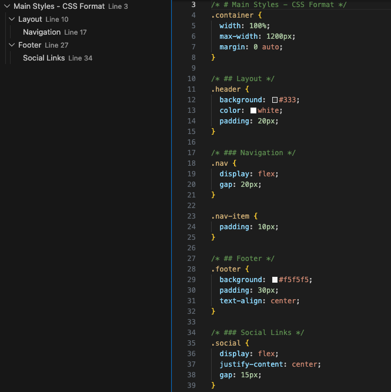

# Mokuji - Table of Contents Generator

A VS Code extension that extends the standard Outline feature by providing comment-based table of contents in the sidebar.

While VS Code's built-in Outline shows code structure (functions, classes, etc.), Mokuji displays custom sections defined by comments and headings, giving you full control over your file's navigation structure.

[日本語版 README](README.ja.md)



## Features

- Recognizes special comment formats and headings, automatically generates a hierarchical table of contents (up to 6 levels)
- Displays in an easy-to-read tree view in the sidebar and preserves the TOC when switching to WebViews (such as Markdown Preview or Settings)
- Click on table of contents items to instantly jump to the corresponding code line
- Updates the table of contents in real-time when editing files
- Supports 14 built-in language IDs out of the box
- Customizable heading markers (`mokuji.headingMarkers`) and workspace regex patterns (`.vscode/mokuji.json`) for any language
- Automatic cursor synchronization (`mokuji.syncCursor`), Collapse All support, and keyboard shortcuts to jump between sections
- Quick section heading insertion (`Mokuji: Insert Section Heading`) and `#` snippet completions inside comments
- Real-time heading lint diagnostics and one-click Quick Fixes (`Ctrl+.` / `Cmd+.`)
- Works 100% offline, with optional AI enhancements via VS Code's Language Model API (`vscode.lm`): Diff-previewed section suggestions, `#mokujiToc` agent tool, and AI instruction generator

## Supported Languages

Mokuji supports the following 14 language IDs out of the box:

| Language | Language ID | Supported Formats | Notes |
|----------|-------------|-------------------|-------|
| CSS | `css` | `/* # Section */` | Block comment |
| SCSS | `scss` | `// # Section`, `/* # Section */` | Line & block comments |
| LESS | `less` | `// # Section`, `/* # Section */` | Line & block comments |
| HTML | `html` | `<!-- # Section -->` | HTML comment |
| Markdown | `markdown` | `# Section` | Native headings (lines inside fenced code blocks `` ``` `` / `~~~` are ignored) |
| JavaScript | `javascript` | `// # Section`, `/* # Section */`, `/** # Section */` | Line, block & JSDoc comments |
| TypeScript | `typescript` | `// # Section`, `/* # Section */`, `/** # Section */` | Line, block & JSDoc comments |
| React JSX | `javascriptreact` | `// # Section`, `/* # Section */`, `/** # Section */`, `{/* # Section */}` | Line, block, JSDoc & JSX comments |
| React TSX | `typescriptreact` | `// # Section`, `/* # Section */`, `/** # Section */`, `{/* # Section */}` | Line, block, JSDoc & JSX comments |
| Python | `python` | `# # Section` | First `#` is the comment prefix; following `#`s specify level (1–6) |
| Java | `java` | `// # Section`, `/* # Section */`, `/** # Section */` | Line, block & Javadoc comments |
| Go | `go` | `// # Section`, `/* # Section */` | Line & block comments |
| Vue | `vue` | `<!-- # Section -->`, `// # Section`, `/* # Section */`, `/** # Section */` | Template, script & style comments |
| Svelte | `svelte` | `<!-- # Section -->`, `// # Section`, `/* # Section */`, `/** # Section */` | Markup, script & style comments |

> For any other language, configure `mokuji.headingMarkers` or `.vscode/mokuji.json` (see [Configuration](#configuration)).

## Usage

### CSS / SCSS / LESS

```css
/* # Main Section */
.main {
  color: blue;
}

/* ## Sub Section */
.sub {
  color: red;
}
```

```scss
// # Main Section
.main {
  color: blue;
}

// ## Sub Section
.sub {
  color: red;
}
```

### HTML

```html
<!-- # Header Section -->
<header>
  <!-- ## Navigation -->
  <nav>...</nav>
</header>

<!-- # Main Content -->
<main>...</main>
```

### Markdown

Fenced code blocks (`` ``` `` or `~~~`) are automatically ignored so `#` comments inside code snippets do not appear in the table of contents.

```markdown
# Main Title

## Section 1

### Subsection 1.1

## Section 2
```

### JavaScript / TypeScript

```javascript
// # Main Section
function main() {
  // ...
}

/* ## Sub Section */
function sub() {
  // ...
}

/** # JSDoc Style Section */
class MyClass {
  // ...
}
```

### React (JSX / TSX)

```tsx
// # Components
export function UserCard({ name }: { name: string }) {
  return (
    <div>
      {/* ## Header */}
      <h2>{name}</h2>
    </div>
  );
}
```

### Python

The leading `#` starts the Python comment, and the following `#` characters (1–6) define the heading level:

```python
# # Data Models
class User:
    name: str

# ## User Service
class UserService:
    # ### Public Methods
    def get_user(self) -> User:
        ...
```

### Vue / Svelte

```vue
<template>
  <!-- # Template -->
  <!-- ## Header -->
  <header>Title</header>
</template>

<script lang="ts">
// # Script
// ## Props
interface Props {
  title: string;
}
</script>

<style>
/* # Styles */
header { padding: 1rem; }
</style>
```

### Go / Java

```go
// # Data Models
type User struct {
	Name string
}

/* # Services */
// ## Public Methods
func GetUser() *User { return nil }
```

```java
/** # Services */
public class UserService {
    // ## Public Methods
    public void run() {}
}
```

### Hierarchy Levels

Use `#` symbols to indicate hierarchy depth (up to 6 levels):

- `#` = Level 1
- `##` = Level 2
- `###` = Level 3
- And so on up to `######` (Level 6)

### Displaying the Table of Contents

1. Open a supported file (any of the 14 built-in languages, or a file with custom configuration)
2. Click the "Mokuji" icon in the activity bar
3. The table of contents will be displayed in the sidebar
4. Click on a table of contents item to jump to the corresponding line

## Navigation & Editing

### Cursor Synchronization & Tree Controls

As you move the cursor in the editor, Mokuji automatically highlights and reveals the active section in the sidebar (`mokuji.syncCursor`, default: `true`). You can also collapse all nested sections at once using the **Collapse All** button in the Mokuji panel header.

### Commands & Keyboard Shortcuts

| Command | Win / Linux | macOS | Description |
|---------|-------------|-------|-------------|
| `Mokuji: Go to Next Section` | `Ctrl+Alt+]` | `Cmd+Alt+]` | Jump to the next section heading in the active editor |
| `Mokuji: Go to Previous Section` | `Ctrl+Alt+[` | `Cmd+Alt+[` | Jump to the previous section heading in the active editor |
| `Mokuji: Insert Section Heading` | — | — | Choose a level (1–6) and title to insert a formatted heading comment |
| `Mokuji: Refresh Table of Contents` | — | — | Manually refresh the Table of Contents view |

### Comment Snippet Completions

Type `#` inside a comment in any supported language to trigger completion snippets for Mokuji section headings (Levels 1–6), automatically formatted for the current language and custom marker settings.

## Heading Lint & Quick Fix

Mokuji automatically checks files for common heading comment mistakes (`mokuji.lint.enabled`, default: `true`) and provides one-click **Quick Fixes** (`Ctrl+.` / `Cmd+.`):

- **Missing spaces**: Detects malformed heading comments such as `//# Section` or `// #Section` and normalizes spacing (e.g., `// # Section`).
- **Skipped heading levels**: Warns when a heading jumps more than one level deeper (such as `#` directly to `###`) and offers a Quick Fix to adjust the level (`##`).
- **Duplicate sibling headings**: Warns when sibling headings under the same parent section share the exact same title.

## AI Assistance & `vscode.lm` Integration

> **Works with or without AI:** Mokuji runs **100% offline** without requiring GitHub Copilot or any AI extension. When a VS Code Language Model (`vscode.lm`, such as GitHub Copilot) is available and `mokuji.ai.enabled` is `"auto"` (default), Mokuji automatically enhances its capabilities.

1. **Suggest Section Headings (`Mokuji: Suggest Section Headings`)**
   Click the `$(sparkle)` button in the Mokuji panel title bar to propose logical section comments for the current file and inspect changes in a **Diff preview** before applying (`Mokuji: Apply Suggested Section Headings`).
   - When `vscode.lm` is available, Mokuji uses the language model to infer meaningful section titles and hierarchy.
   - When no AI model is available—or when `mokuji.ai.enabled` is set to `"off"`—Mokuji automatically falls back to **offline code-structure rules** (using VS Code symbols and declaration patterns).
2. **Language Model Tool `mokuji_getToc` (`#mokujiToc`)**
   Exposes a file's Mokuji Table of Contents (headings, hierarchy levels, and 1-indexed line ranges) as a native VS Code Language Model Tool. In Copilot Chat / Agent mode, reference `#mokujiToc` or let AI agents invoke `mokuji_getToc` to navigate large files efficiently without reading the entire file into context.
3. **Generate AI Heading Instructions (`Mokuji: Generate AI Heading Instructions`)**
   Generates workspace-aware Mokuji heading conventions (including any custom `mokuji.headingMarkers` or `.vscode/mokuji.json` rules) into `AGENTS.md`, `.github/copilot-instructions.md`, or `CLAUDE.md` so external AI coding assistants write valid Mokuji headings.

## Configuration

When parsing a file, Mokuji resolves patterns per language ID in the following **priority order**:

1. **`mokuji.headingMarkers`** (User / Workspace `settings.json`)
2. **`.vscode/mokuji.json`** (Workspace custom regex configuration)
3. **Built-in language patterns**

If a higher-priority configuration is defined for a language ID, lower-priority patterns are not used for that language.

### 1. Show / Hide Line Numbers (`mokuji.showLineNumber`)

Controls whether `Line XX` is displayed next to each item in the Mokuji sidebar panel (default: `true`).

```json
{
  "mokuji.showLineNumber": true
}
```

### 2. Custom Heading Markers (`mokuji.headingMarkers`)

You can define custom heading markers for any language ID using `mokuji.headingMarkers` in `settings.json`:

```json
{
  "mokuji.headingMarkers": {
    "python": ["@", "$", "&"],
    "ruby": ["MARK:", "MARK::", "MARK:::"]
  }
}
```

Each array element corresponds to a heading level (1–6). Common comment styles (`#`, `//`, `/* ... */`, `/** ... */`, `<!-- ... -->`, and `{/* ... */}`) are automatically recognized. For example, with the Python configuration above:

```python
# @ Main Section        <- Level 1
# $ Sub Section         <- Level 2
# & Details             <- Level 3
```

When `mokuji.headingMarkers` is configured for a language, it overrides `.vscode/mokuji.json` and the default `#` pattern for that language.

### 3. Workspace Regex Patterns (`.vscode/mokuji.json`)

For full control over matching rules at the project level, create `.vscode/mokuji.json` in your workspace root. Changes to `.vscode/mokuji.json` are watched and reloaded automatically in real time.

Each entry under `parsers.<languageId>.patterns` accepts:

- `regex` (`string`): Regular expression string matched against each line
- `levelGroup` (`number`): 1-indexed capture group whose **matched string length** determines the heading level (e.g., `"=="` = level 2)
- `labelGroup` (`number`): 1-indexed capture group used as the heading label

Example `.vscode/mokuji.json`:

```json
{
  "parsers": {
    "ruby": {
      "patterns": [
        {
          "regex": "^\\s*#\\s*(=+)\\s+(.+)$",
          "levelGroup": 1,
          "labelGroup": 2
        }
      ]
    },
    "sql": {
      "patterns": [
        {
          "regex": "^\\s*--\\s*(#{1,6})\\s+(.+)$",
          "levelGroup": 1,
          "labelGroup": 2
        }
      ]
    }
  }
}
```

With the configuration above, `# = Section` is parsed as Level 1 and `# == Subsection` as Level 2 in Ruby files, and `-- # Queries` as Level 1 in SQL files.

### 4. Cursor Synchronization (`mokuji.syncCursor`)

Automatically highlights and reveals the active section in the Mokuji sidebar when the editor cursor moves (default: `true`).

```json
{
  "mokuji.syncCursor": true
}
```

### 5. Heading Lint & Quick Fixes (`mokuji.lint.enabled`)

Enables diagnostics and Quick Fixes for malformed Mokuji heading comments, skipped heading levels, and duplicate sibling headings (default: `true`).

```json
{
  "mokuji.lint.enabled": true
}
```

### 6. AI Integration Mode (`mokuji.ai.enabled`)

Controls whether `Mokuji: Suggest Section Headings` uses VS Code's built-in Language Model API (`vscode.lm`) when available (`"auto"`, default) or always uses offline code-structure rules (`"off"`).

```json
{
  "mokuji.ai.enabled": "auto"
}
```

## Installation

### From VS Code Marketplace

Search for "Mokuji" in the VS Code Extensions view and install (requires VS Code `1.95.0` or newer).

### Running the Development Version

1. Clone this repository
2. Install dependencies with `npm install`
3. Compile with `npm run compile`
4. Press F5 to launch the Extension Development Host

## Development

```bash
# Install dependencies
npm install

# Compile TypeScript
npm run compile

# Run unit tests
npm run test:unit

# Run VS Code integration tests
npm run test:integration

# Run integration tests on headless Linux
xvfb-run -a npm run test:integration

# Watch mode (auto-compile)
npm run watch
```

## License

MIT
